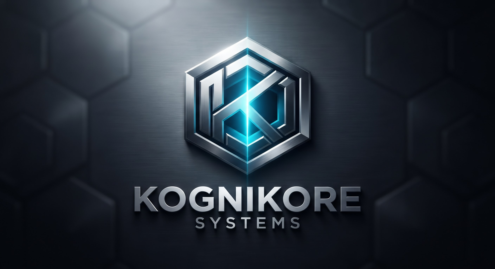

# KOGNIKORE SYSTEMS
### *Swiss Software Engineering & Systems Architecture*

---

## English

### Overview

**KogniKore Systems** is an independent software and systems engineering initiative based in Switzerland, dedicated to the design and development of proprietary enterprise software solutions.

To protect intellectual property and commercial confidentiality, product roadmaps, functional scope, domain models, and internal system architectures are not disclosed publicly.

### Intellectual Property & Confidentiality Notice

© 2026 KogniKore Systems. All rights reserved.

This repository serves strictly as an institutional landing page. All associated source code, technical specifications, algorithms, and operational methodologies constitute confidential trade secrets and proprietary intellectual property.

- **Access & Disclosure:** Strictly restricted to authorized parties under written Non-Disclosure Agreements (NDA).
- **Prohibited Use:** Any unauthorized reproduction, reverse engineering, decompilation, or derivative use is strictly prohibited and subject to civil and criminal enforcement under Swiss Federal Law (URG / UWG / Art. 162 StGB) and applicable international treaties.

---

## Deutsch

### Überblick

**KogniKore Systems** ist eine unabhängige Software- und System-Engineering-Initiative mit Sitz in der Schweiz, die sich auf die Konzeption und Entwicklung proprietärer Unternehmenssoftware konzentriert.

Zum Schutz des geistigen Eigentums und der Geschäftsgeheimnisse werden Produkt-Roadmaps, Funktionsumfang, Domänenmodelle sowie interne Systemarchitekturen nicht öffentlich offengelegt.

### Hinweis zu geistigem Eigentum und Vertraulichkeit

© 2026 KogniKore Systems. Alle Rechte vorbehalten.

Dieses Repository dient ausschliesslich als institutionelle Informationsseite. Sämtlicher zugehöriger Quellcode, technische Spezifikationen, Algorithmen und betriebliche Methoden stellen vertrauliche Geschäftsgeheimnisse und geschütztes geistiges Eigentum dar.

- **Zugang & Offenlegung:** Ausschliesslich für autorisierte Parteien im Rahmen schriftlicher Geheimhaltungsvereinbarungen (NDA).
- **Unzulässige Nutzung:** Jede unbefugte Vervielfältigung, Rückentwicklung (Reverse Engineering), Dekompilierung oder abgeleitete Nutzung ist strengstens untersagt und wird nach schweizerischem Bundesrecht (URG / UWG / Art. 162 StGB) sowie geltenden internationalen Abkommen zivil- und strafrechtlich verfolgt.

---

**Contact / Kontakt:** kognikore.systems@gmail.com